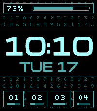
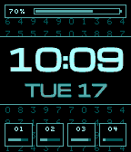
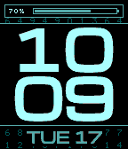
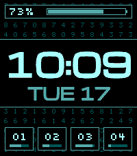
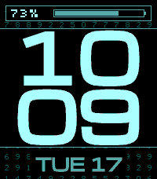
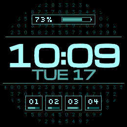
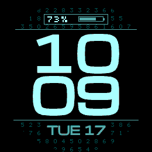

# Refinement

A very usable and legible watchface inspired by the Macrodata Refinement activity
from Apple TV's Severance show.



Every few minutes the old time agitates and drops into a bin, while the new
digits are found in the field of numbers and glide into place.

## Features

- **Two styles.** Standard puts the time and date in a band with four bins below.
  Large stacks the hours over the minutes in big digits.
- **Refinement animation** every 5 minutes, or at an interval you choose:
  1, 5, 10, 15 or 30 minutes, 1 hour, or never.
- **Eight colour themes:** cyan, green, amber, red, magenta, blue, yellow and white.
  Each keeps the same bright, mid and dim steps for the time, date and field.
- **Legible:** bold, anti-aliased digits, positioned at sub-pixel precision.
- Battery level in the header.

| Pebble Time | Pebble Time 2 | Pebble Round 2 |
|---|---|---|
|   |   |   |

## Building

Needs the Pebble SDK (pebble-tool 5.x, SDK 4.44 or later) and Node.js.

```
npm install
pebble build
pebble install --emulator emery     # or --cloudpebble for a watch via the phone app
```

The time font is Michroma, converted for [pebble-fctx](https://www.npmjs.com/package/pebble-fctx)
and thickened for legibility by `tools/build_fonts.py`. The settings page uses
[Clay](https://www.npmjs.com/package/@rebble/clay). See `docs/DESIGN_SPEC.md`
for the design and `CLAUDE.md` for development notes and preview build flags.

## Licence

GPL-3.0-or-later (see `LICENSE`). The bundled fonts, Michroma and Silkscreen, are
under the SIL Open Font License (`resources/fonts/OFL-*.txt`).

Refinement is a fan-made watchface. It is not affiliated with or endorsed by Apple
or the makers of Severance, and it uses no show logos or branding.
